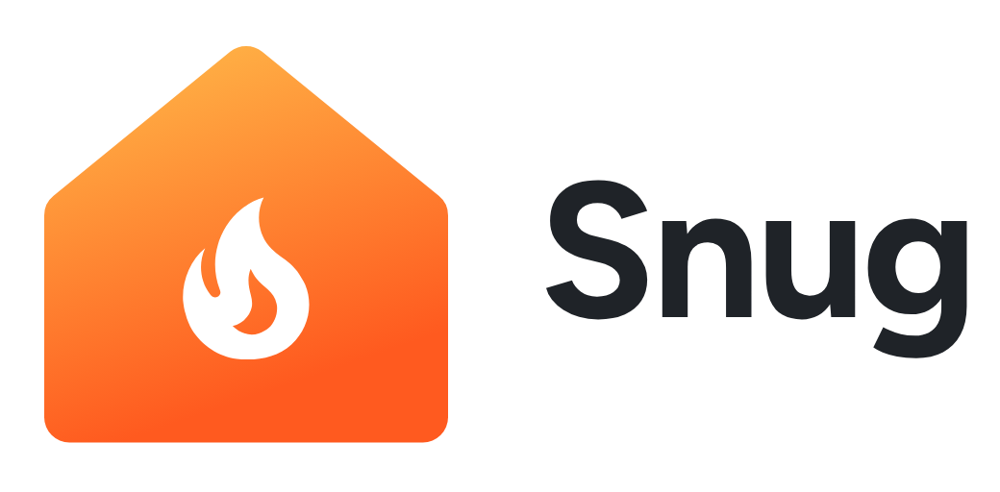
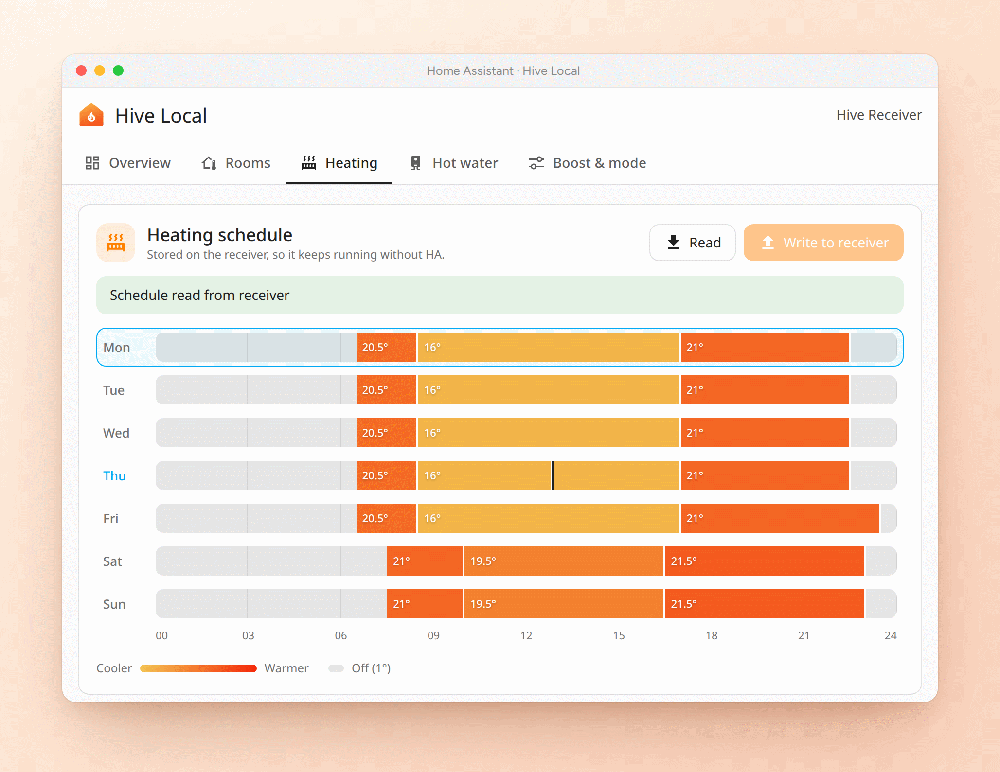
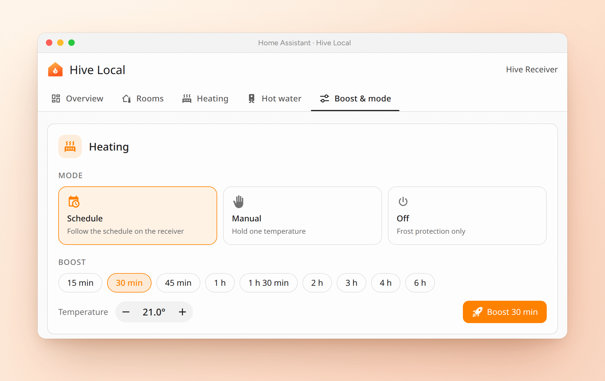

<h1 align="center">
  <picture>
    <source media="(prefers-color-scheme: dark)" srcset="https://raw.githubusercontent.com/elliotwestlake/hive-local/main/docs/logo/logo-dark.png">
    
  </picture>
</h1>

<!-- ha-marketplace:exclude-start -->
[](https://my.home-assistant.io/redirect/marketplace_repository/?owner=elliotwestlake&repository=hive-local&category=integration)
<!-- ha-marketplace:exclude-end -->

Local control of Hive heating and hot water from Home Assistant, with no Hive cloud and no Hive hub. It adds a **Hive** sidebar panel and entities for boost and mode. Schedules are written to the receiver itself, so they keep running if HA is down.


Works with Hive receivers (SLR1, SLR1b/c/d, OTR1, SLR2, SLR2b/c/d) paired to **Zigbee2MQTT** or **ZHA**.

Hive Local is an independent community project. It isn't affiliated with, endorsed by or supported by Hive or Centrica. "Hive" is used only to describe the hardware it works with.

> ⚠️ Early and experimental. Z2M includes the standard Zigbee `setWeeklySchedule` / `getWeeklySchedule` commands for these receivers but hides them from its UI. Reading works on a real SLR1-style receiver. Writing is still being tested, so read before you write, and check the change shows on the thermostat.

## Install

**Marketplace** (HA 2026.11+, formerly HACS): use the **Open your Home Assistant instance** button above, or go to **Settings → Marketplace** → ⋮ → Custom repositories → add this repo as an *Integration*. Install it, then restart HA. On older HA, use the same steps in HACS.

**Manual:** copy `custom_components/hive_local` into your HA `config/custom_components/`, then restart.

Then add the integration:

[](https://my.home-assistant.io/redirect/config_flow_start/?domain=hive_local)

Or go to **Settings → Devices & services → Add integration → Hive Local**. Choose how the receiver is connected:

- **Zigbee2MQTT:** confirm the base topic (default `zigbee2mqtt`), then pick your receiver from the list.
- **ZHA:** pick the receiver from your ZHA devices (the SLR/OTR receiver, not the wall thermostat).

The receiver type (heating only, or heating + hot water) is detected automatically.

## The Hive panel

- **Overview:** each channel's current temperature, mode, heating/idle, and boost time left. Click a card to open its controls.
- **Heating** / **Hot water:** the weekly schedule editor. **Read** fetches the schedule from the receiver (also on open). Edit a day, use **Copy to** for weekdays, the weekend or every day, then **Write to receiver**. One command is sent for each group of identical days.
- **Boost & mode:** switch between Schedule, Manual (a fixed temperature) and Off, start a boost for a set time (and temperature, for heating), or cancel one.

Schedule limits: 6 events per day, setpoints 1–32 °C in 0.5 steps.






## Entities and actions

**`climate.<receiver>_heating`**: the main heating control.
- **HVAC modes:** `auto` follows the onboard schedule, `heat` holds the target temperature, `off` is off.
- **Target temperature:** works like turning the thermostat dial. On `auto`, it overrides the schedule until the next scheduled change (up or down). On `heat`, it changes the held temperature. During a boost, it changes the boost temperature and keeps the time left. During a schedule "off" period (Hive reports 1 °C) the target shows your frost protection temperature (below), so you can still adjust it.
- **Boost preset:** uses the boost defaults below. Clearing it goes back to the previous mode.

**`water_heater.<receiver>_hot_water`** (SLR2 only): Schedule / On / Off / Boost. Turn on goes back to Schedule.

Also, for each channel:

| Entity | What it does |
|---|---|
| `select.<receiver>_heating_mode` | Schedule / Manual / Off / Boost. Picking Boost uses the boost defaults below. |
| `sensor.<receiver>_heating_boost_remaining` | Minutes left on a boost, 0 when not boosting. |
| `sensor.<receiver>_temperature` | Room temperature reported by the thermostat (heating only), with long-term statistics. |
| `button.<receiver>_boost_heating` / `cancel_heating_boost` | Start or cancel a boost. |
| `number.<receiver>_heating_boost_duration` / `heating_boost_temperature` | Defaults used by the button, the select and the actions. These are stored in HA, not on the receiver. |
| `number.<receiver>_heating_frost_protection` | Set this to match the frost protection on your Hive thermostat (default 12 °C). During a schedule "off" period the receiver reports 1 °C, so this is shown as the target instead. Display only: it's never sent to the receiver. |

Actions: `hive_local.boost_heating` (`minutes`, `temperature`), `hive_local.boost_water` (`minutes`), `hive_local.cancel_boost_heating`, `hive_local.cancel_boost_water`. Each takes an optional `device_id`, which is only needed if you have more than one receiver. Cancelling a boost returns the channel to whatever it was doing before. If the receiver is still boosting a couple of minutes after a boost should have ended (it can lose track of the time), Hive Local ends it for you the same way.

```yaml
action: hive_local.boost_heating
data:
  minutes: 60
  temperature: 21
```

### Replacing Zigbee2MQTT's or ZHA's own entities

Zigbee2MQTT's MQTT discovery and ZHA both create their own climate entities for the receiver. Those don't know about Hive's schedule/manual/boost behaviour. Once Hive Local is working, disable them in HA: **Settings → Devices & services → MQTT (or ZHA) → the receiver → the climate entities → ⚙ → Enabled: off**. Zigbee2MQTT or ZHA keeps handling the Zigbee side, and Hive Local's entities become the only ones you use.

### ZHA: receiver light goes red every few minutes

On ZHA, a Hive receiver can lose its wall thermostat every few minutes: the light turns red, the boiler switches off, and the thermostat says "No signal". ZHA sets the thermostat to report its temperature only every 15 minutes, and the receiver gives up on it long before that ([zha-device-handlers#2776](https://github.com/zigpy/zha-device-handlers/issues/2776)).

Hive Local fixes this for you on ZHA: it finds Hive SLT thermostats and sets them to report at least every 2 minutes. The thermostat sleeps, so this happens just after it next reports (within 15 minutes), and it's re-applied daily in case ZHA reconfigures it. The log shows `Hive thermostat … now reports temperature at least every 120 s` once it's done.

If the thermostat says it isn't paired at all, re-pair it through the receiver: factory-reset the thermostat, then in ZHA open the receiver and use **Add devices via this device**.

### Hot water values

The setpoints the receiver uses for hot water on/off in a schedule are **not yet confirmed**. They default to `WATER_ON = 22` and `WATER_OFF = 1` in `const.py`. Read your existing hot water schedule first. If the panel shows values like `22°?`, update the constants to match.

## Test it by hand (Z2M → device → Dev console)

Run the `getWeeklySchedule` command on the `hvacThermostat` cluster (endpoint 5 on SLR2) with `{"daystoreturn": 127, "modetoreturn": 1}`. The Z2M log should show one `weekly_schedule` (SLR1) or `weekly_schedule_heat` (SLR2) message per day.

## Acknowledgements

- **[Hive Local Thermostat](https://github.com/andrew-codechimp/HA-Hive-Local-Thermostat)** by Andrew Jackson showed how to drive Hive receivers locally through Zigbee2MQTT. Hive Local's boost, cancel-boost and mode entities, its actions and its frost protection setting were designed to match it, so moving across feels familiar. That integration is now retired.
- **[HomeDash's fork](https://github.com/homedashHA/HA-Hive-Local-Thermostat)** keeps Hive Local Thermostat going. Its fix for receivers that lose track of a boost inspired Hive Local's own boost deadline.
- **[zha-device-handlers#2776](https://github.com/zigpy/zha-device-handlers/issues/2776)**, where the ZHA "receiver goes red" problem was tracked down to the thermostat's reporting interval.
- **[Zigbee2MQTT](https://www.zigbee2mqtt.io/)** and **[zigpy](https://github.com/zigpy/zigpy)**, whose device definitions document the Hive receivers' schedule and hold attributes.

## Development

```bash
cd frontend && npm install && npm run build   # writes custom_components/hive_local/frontend/hive-local-panel.js
npm run watch                                  # rebuild on change
pytest -q tests                                # pure logic tests (no HA needed)
```

The built bundle is committed so Marketplace users don't need a build step.

### Screenshots and logo

The README screenshots are the real panel bundle rendered with sample data. `docs/screenshots/harness/` has `harness.html` (a fake `hass` with HA's theme colours) and `compose.html` (the window frames, the desktop + phone hero and the social preview). To retake them after a panel change, serve that folder with the built `hive-local-panel.js` and an `icons.json` (from `build_icons.mjs`, which needs `@mdi/js`), then capture with headless Chrome:

- **Raw tabs** (to `docs/screenshots/raw/`): `chrome-headless-shell --screenshot --window-size=900,620 --force-device-scale-factor=2 "http://127.0.0.1:8765/harness.html?tab=Overview"` (`tab=`, `narrow=1`, `theme=dark`).
- **Framed:** `compose.html?kind=frame&img=schedule.png&w=900` (add `&theme=night` for the dark shot), `?kind=hero` and `?kind=social&logo=…/logo.svg`.

The logo lives in `docs/logo/`: `icon.svg`, `logo.svg` and `logo-dark.svg` (for dark backgrounds), all with the text converted to outlines, plus PNG exports and `social-preview.png` (1280×640). `make_logo.py` regenerates the SVGs (`pip install fonttools`; the wordmark is Figtree, SIL Open Font License, and the script shows where to download it). The integration's `brand/` images are rendered from the same SVGs.
