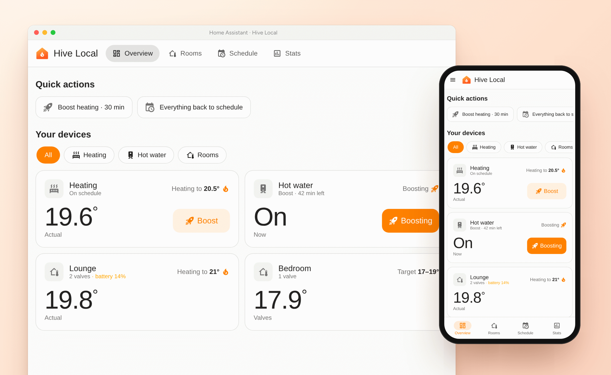
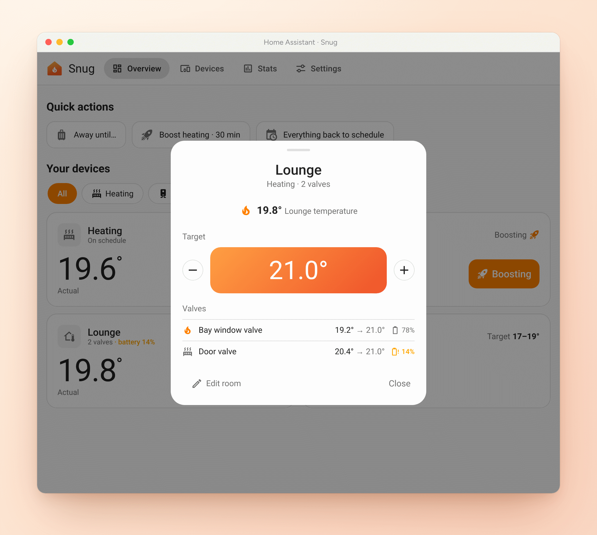

<h1>
  <picture>
    <source media="(prefers-color-scheme: dark)" srcset="https://raw.githubusercontent.com/elliotwestlake/hive-local/main/docs/logo/logo-dark.png">
    
  </picture>
</h1>

<!-- ha-marketplace:exclude-start -->
[](https://my.home-assistant.io/redirect/marketplace_repository/?owner=elliotwestlake&repository=hive-local&category=integration)
<!-- ha-marketplace:exclude-end -->

Local control of Hive heating and hot water from Home Assistant, with no Hive cloud and no Hive hub. It adds a **Hive** sidebar panel and entities for boost and mode. Schedules are written to the receiver itself, so they keep running if HA is down.



Works with Hive receivers (SLR1, SLR1b/c/d, OTR1, SLR2, SLR2b/c/d) paired to **Zigbee2MQTT** or **ZHA**.

Hive Local is an independent community project. It isn't affiliated with, endorsed by or supported by Hive or Centrica. "Hive" is used only to describe the hardware it works with.

> ⚠️ Early and experimental. Z2M includes the standard Zigbee `setWeeklySchedule` / `getWeeklySchedule` commands for these receivers but hides them from its UI. Reading works on a real SLR1-style receiver. Writing is still being tested, so read before you write, and check the change shows on the thermostat.

## Install

**Marketplace** (HA 2026.11+, formerly HACS): use the **Open your Home Assistant instance** button above, or go to **Settings → Marketplace** → ⋮ → Custom repositories → add this repo as an *Integration*. Install it, then restart HA. On older HA, use the same steps in HACS.

**Manual:** copy `custom_components/hive_local` into your HA `config/custom_components/`, then restart.

Then add the integration:

[](https://my.home-assistant.io/redirect/config_flow_start/?domain=hive_local)

Or go to **Settings → Devices & services → Add integration → Hive Local**. Choose how the receiver is connected:

- **Zigbee2MQTT:** confirm the base topic (default `zigbee2mqtt`), then pick your receiver from the list.
- **ZHA:** pick the receiver from your ZHA devices (the SLR/OTR receiver, not the wall thermostat).

The receiver type (heating only, or heating + hot water) is detected automatically.

## The Hive panel

Four tabs: Overview, Devices, Stats and Settings. On a phone they move to a bar along the bottom of the screen. Heating and hot water each have their own page, opened from their card on the Overview, with **Control**, **Schedule** and **History** tabs.

- **Overview:** **Quick actions** (boost heating or hot water with your defaults, **Away until…**, or put everything back on its schedule), and **Your devices**, with filters, a card each for heating, hot water and your rooms. Each card shows the temperature (or On/Off), what it's doing (with a tick once a room is up to temperature), and **Boost**: it opens a sheet to pick the temperature (heating) and how long, then **Boost to 22.0° for 2 h**. While boosting the button reads **Boosting**, and opens the time left and **Stop boost**. Tap a heating or hot water card to open its page. **Control** has **−** / **+** for the heating target (like the thermostat: on Schedule it lasts until the next scheduled change, on Manual it changes the held temperature, during a boost it keeps the time left), and Schedule / Manual / Off. Tap a room to open it in a pop-up (from the bottom on a phone): its temperature, **−** / **+** for the room's target, each valve with its reading and battery, and **Edit room**.
- **Away until…** (a quick action): holiday mode. See [Holiday](#holiday).
- **Pre-heat** (on the heating page's **Control** tab): starts heating early so the house is warm at the time your schedule says, rather than only starting to warm up then. See [Pre-heat](#pre-heat).
- **Schedule** (on the heating or hot water page): says whether your schedule is in use, then a row of days (M–S). Pick a day to see its times, like "06:30 – 08:30" with the temperature in a circle (a snowflake means off). Tap a time to change when it starts or its temperature, or remove it; **Add a time** adds one. The **⋯** button reads the schedule from the receiver again or copies the day to weekdays, the weekend or every day. Changes are kept in the panel until you press **Save** on the **Unsaved changes** bar, which writes them to the receiver, and only the days you changed are sent, one command per day, so the rest of the week is never rewritten.
- **Devices:** a card for each device: your receivers (model, Zigbee2MQTT or ZHA, online, and links to its Heating and Hot water pages) and every Hive radiator valve (its room, battery, whether it's responding, and its temperature). The **+** button adds a receiver (Home Assistant's setup for Hive Local) or explains how to pair a valve.
- **Stats:** see [Stats](#stats).
- **Settings:** the outside temperature for Stats (a weather entity or an outdoor sensor), the boiler's output and gas price for an estimated heating cost, your rooms (see [Rooms](#rooms-and-radiator-valves)), and for each receiver the **Boost** defaults (how long, and the heating temperature) and heating **frost protection** (the target shown while the schedule has the heating off; display only). These are the same settings as the receiver's number entities in Home Assistant, so automations see them.

With more than one receiver, the Overview shows every receiver's heating and hot water cards (each opens its own page), and Stats has a tab per receiver.

Schedule limits: 6 events per day, setpoints 1–32 °C in 0.5 steps.


## Rooms and radiator valves

Rooms group your **Hive radiator valves** (UK7004240) whether they're paired with ZHA or Zigbee2MQTT. Hive Local recognises them by model and uses their climate entities. Set them up under **Settings → Rooms**; each room then has a card on the Overview.

- **Set up rooms from your areas:** shown while any Home Assistant area has Hive valves that aren't in a room. It suggests a room per area with its valves and the area's temperature sensor, if it has one (not a valve's own). Untick any you don't want and press **Create**. With more than one receiver, pick which one heats each room.
- **Add a room** or tap a room to edit it: a name, its valves, and optionally a temperature sensor (without one, the room shows the average of its valves' readings). The valves are a scrolling list, the likely ones first (this room's, the area matching its name, then valves not in a room yet), with a search box when you have more than 8. Each shows its area, reading and battery, and which room it's in already.
- **Find** (the bulb) makes a valve flash its light, to tell which is which. It appears when Home Assistant has an Identify button for the valve (ZHA adds one; Zigbee2MQTT only if it exposes identify).
- Rooms cover the whole house. With more than one receiver (heating zones), each room says which one heats it (**Heated by**).
- Tap a room's card on the Overview for its temperature, whether any valve is heating, each valve's reading, target and battery (low batteries are flagged), and one **target** that sets all the room's valves at once.



Coming next: the valves using the room sensor's reading (their external sensor setting), and, optionally, rooms calling for heat from the boiler.

## Stats

The **Stats** tab shows how long the boiler ran, laid out as a history:

- Pick **D**, **W** or **M** (a day, a week or a month) and **time on** or **temperature**, and step back to earlier periods with the arrows either side of the date.
- A summary at the top (for example **Boiler on 22h 58m** and **Average per day 3h 17m**), with the change from the period before, how often it fired up and the boosts.
- Then a row per day (per hour for a day): a bar, the time on or average temperature, the temperature outside (if set, below) and that day's lowest and highest room temperature.
- **Outside temperature (optional):** pick a weather entity or an outdoor temperature sensor in the panel's **Settings** tab. Each row then shows the day's low and high outside, and the note under the summary says the average and whether it was colder or milder than the period before. It comes from the same recorder history, so it covers whatever that entity has recorded.
- **Estimated cost (optional):** a third toggle (the banknote icon) shows the heating's cost: the boiler's time on × its average output while on × the gas price per kWh. Set it up in **Settings → Heating cost**:
  - **Gas meter (best):** pick your gas meter (the Energy dashboard's gas source, or any gas sensor, e.g. from your energy supplier's integration). Hive Local learns the boiler's real average output from the last 14 days: each day's gas use against the hours the boiler was on, allowing for hot water and cooking on the same meter. It needs at least 4 days of readings with the heating on, and re-learns every 6 hours.
  - **Boiler rating:** without a gas meter, enter the boiler's rated output (kW). It's counted at 40%, since a modern boiler turns its flame down and rarely runs flat out; the real figure varies, so a gas meter is much closer.
  - **Gas price:** from the Energy dashboard (your gas source's price), a sensor or number with a price per kWh or per m³ (for example a tariff sensor), or **Unit rate**: your gas unit rate from your bill, set with − / + in pence (0.01p a tap; hold to go faster). Prices per m³ are converted at 11.2 kWh/m³.
  
  It's an estimate, at today's price for the whole period. Heating only: hot water shares the boiler.
- The Stats tab is the heating history, with a tab for each receiver if you have several. Each heating or hot water page has the same history for just that one, under **History**.

It's worked out from Home Assistant's own history of the Hive Local heating and hot water entities, so it needs the recorder (on by default) and starts from when you installed Hive Local. The recorder keeps 10 days unless you raise `purge_keep_days`, so months and earlier weeks need that too.


## Pre-heat

Off by default. Turn it on from the heating page's **Control** tab, or with `switch.<receiver>_pre_heat`.

- **How fast your home warms up** is learned from Home Assistant's history of the heating: each time the boiler ran from at least 1° below the target for 20 minutes or more, how quickly the temperature rose. It takes the middle value of the last 14 days, and starts once it has seen 3 warm-ups (the card says how many so far).
- **When to start:** before each rise in the schedule (say 16° to 20° at 06:30), it works out how long the climb takes from the current temperature, adds 10 minutes, and starts then. **Start at most** (default 2 h, `number.<receiver>_pre_heat_starts_at_most`) caps how early that can be.
- **How:** it boosts to the new temperature until the scheduled time, so the cards say **Pre-heating for 06:30**. When the boost ends the receiver is already on the new temperature, and if Home Assistant stops halfway, the receiver ends the boost itself and carries on with its schedule. Only from Schedule mode, never on Manual or Off, and never over a boost you started. If you stop a pre-heat, that change is left alone. Stats counts pre-heating as following the schedule, not as a boost.
- **The schedule** is the one on the receiver. Hive Local keeps a copy whenever the panel reads or saves it, reads it when you turn pre-heat on (if it hasn't got a full week yet), and reads it again every night at 03:17, because the thermostat can change it too.

Needs the recorder (it's on by default in Home Assistant).

## Holiday

**Away until…** on the Overview (or `hive_local.set_holiday`) holds the heating at a low temperature and turns the hot water off until the date and time you pick, then puts everything back to what it was doing before (the schedule, or your manual hold). It covers every receiver. The temperature defaults to your frost protection setting (`number.<receiver>_heating_frost_protection`, 12 °C unless you've changed it).

- The cards say **Away until Sat 14:00**, and **End holiday** (a quick action, or **End** on the heating or hot water page) comes back early.
- A boost while you're away is fine: when it ends, the heating goes back to the holiday temperature. **−** / **+** changes the holiday temperature.
- If anyone changes the mode while you're away (on the thermostat, the mode select, **Everything back to schedule**), the holiday ends there and their change stays.
- The receivers have no holiday mode of their own, so Home Assistant switches both ends. The end time is saved, so it survives a restart. **If Home Assistant is down when the holiday ends**, the receiver keeps holding the holiday temperature (frost protection, so nothing freezes, but the house stays cold) until Home Assistant is back, and then it resumes straight away.
- Radiator valves in your rooms aren't changed.

## Entities and actions

**`climate.<receiver>_heating`**: the main heating control.
- **HVAC modes:** `auto` follows the onboard schedule, `heat` holds the target temperature, `off` is off.
- **Target temperature:** works like turning the thermostat dial. On `auto`, it overrides the schedule until the next scheduled change (up or down). On `heat`, it changes the held temperature. During a boost, it changes the boost temperature and keeps the time left. During a schedule "off" period (Hive reports 1 °C) the target shows your frost protection temperature (below), so you can still adjust it.
- **Boost preset:** uses the boost defaults below. Clearing it goes back to the previous mode.
- **Away preset:** shown while on [holiday](#holiday); clearing it ends the holiday. It's started with `hive_local.set_holiday` (it needs an end time). The `holiday_until` attribute (also on the hot water entity) says when it ends.

**`water_heater.<receiver>_hot_water`** (SLR2 only): Schedule / On / Off / Boost. Turn on goes back to Schedule.

Also, for each channel:

| Entity | What it does |
|---|---|
| `select.<receiver>_heating_mode` | Schedule / Manual / Off / Boost. Picking Boost uses the boost defaults below. |
| `sensor.<receiver>_heating_boost_remaining` | Minutes left on a boost, 0 when not boosting. |
| `sensor.<receiver>_temperature` | Room temperature reported by the thermostat (heating only), with long-term statistics. |
| `button.<receiver>_boost_heating` / `cancel_heating_boost` | Start or cancel a boost. |
| `number.<receiver>_heating_boost_duration` / `heating_boost_temperature` | Defaults used by the button, the select and the actions. These are stored in HA, not on the receiver. |
| `switch.<receiver>_pre_heat` / `number.<receiver>_pre_heat_starts_at_most` | [Pre-heat](#pre-heat) on or off, and how early it may start (15–240 minutes). Stored in HA. |
| `number.<receiver>_heating_frost_protection` | Set this to match the frost protection on your Hive thermostat (default 12 °C). During a schedule "off" period the receiver reports 1 °C, so this is shown as the target instead. Also the default [holiday](#holiday) temperature. Otherwise display only. |

Actions: `hive_local.boost_heating` (`minutes`, `temperature`), `hive_local.boost_water` (`minutes`), `hive_local.cancel_boost_heating`, `hive_local.cancel_boost_water`. Each takes an optional `device_id`, which is only needed if you have more than one receiver. `hive_local.set_holiday` (`until`, optional `temperature`) and `hive_local.cancel_holiday` cover every receiver unless you pass a `device_id`; see [Holiday](#holiday). Cancelling a boost returns the channel to whatever it was doing before. If the receiver is still boosting a couple of minutes after a boost should have ended (it can lose track of the time), Hive Local ends it for you the same way.

```yaml
action: hive_local.boost_heating
data:
  minutes: 60
  temperature: 21
```

### Replacing Zigbee2MQTT's or ZHA's own entities

Zigbee2MQTT's MQTT discovery and ZHA both create their own climate entities for the receiver. Those don't know about Hive's schedule/manual/boost behaviour. Once Hive Local is working, disable them in HA: **Settings → Devices & services → MQTT (or ZHA) → the receiver → the climate entities → ⚙ → Enabled: off**. Zigbee2MQTT or ZHA keeps handling the Zigbee side, and Hive Local's entities become the only ones you use.

### ZHA: receiver light goes red every few minutes

On ZHA, a Hive receiver can lose its wall thermostat every few minutes: the light turns red, the boiler switches off, and the thermostat says "No signal". ZHA sets the thermostat to report its temperature only every 15 minutes, and the receiver gives up on it long before that ([zha-device-handlers#2776](https://github.com/zigpy/zha-device-handlers/issues/2776)).

Hive Local fixes this for you on ZHA: it finds Hive SLT thermostats and sets them to report at least every 2 minutes. The thermostat sleeps, so this happens just after it next reports (within 15 minutes), and it's re-applied daily in case ZHA reconfigures it. The log shows `Hive thermostat … now reports temperature at least every 120 s` once it's done.

If the thermostat says it isn't paired at all, re-pair it through the receiver: factory-reset the thermostat, then in ZHA open the receiver and use **Add devices via this device**.

### Hot water values

The setpoints the receiver uses for hot water on/off in a schedule are **not yet confirmed**. They default to `WATER_ON = 22` and `WATER_OFF = 1` in `const.py`. Read your existing hot water schedule first. If the panel shows values like `22°?`, update the constants to match.

## Test it by hand (Z2M → device → Dev console)

Run the `getWeeklySchedule` command on the `hvacThermostat` cluster (endpoint 5 on SLR2) with `{"daystoreturn": 127, "modetoreturn": 1}`. The Z2M log should show one `weekly_schedule` (SLR1) or `weekly_schedule_heat` (SLR2) message per day.

## Acknowledgements

- **[Hive Local Thermostat](https://github.com/andrew-codechimp/HA-Hive-Local-Thermostat)** by Andrew Jackson showed how to drive Hive receivers locally through Zigbee2MQTT. Hive Local's boost, cancel-boost and mode entities, its actions and its frost protection setting were designed to match it, so moving across feels familiar. That integration is now retired.
- **[HomeDash's fork](https://github.com/homedashHA/HA-Hive-Local-Thermostat)** keeps Hive Local Thermostat going. Its fix for receivers that lose track of a boost inspired Hive Local's own boost deadline.
- **mikestir**, who tracked the ZHA "receiver goes red" problem down to the thermostat's reporting interval in [zha-device-handlers#2776](https://github.com/zigpy/zha-device-handlers/issues/2776). Hive Local applies that fix automatically.
- The **[Drayton Wiser integration](https://github.com/asantaga/wiserHomeAssistantPlatform)**, whose sidebar panel inspired the Hive panel.
- **[Zigbee2MQTT](https://www.zigbee2mqtt.io/)** and **[zigpy](https://github.com/zigpy/zigpy)**, whose device definitions document the Hive receivers' schedule and hold attributes.

## Development

```bash
cd frontend && npm install && npm run build   # writes custom_components/hive_local/frontend/hive-local-panel.js
npm run watch                                  # rebuild on change
pytest -q tests                                # pure logic tests (no HA needed)
```

The built bundle is committed so Marketplace users don't need a build step.

### Screenshots and logo

The README screenshots are the real panel bundle rendered with sample data. `docs/screenshots/harness/` has `harness.html` (a fake `hass` with HA's theme colours and sample rooms), `compose.html` (window frames, the desktop + phone hero and the social preview) and `shoot.sh`, which retakes all of them after `npm run build`:

```bash
CHROME=/path/to/chrome-headless-shell PYTHON=python3 docs/screenshots/harness/shoot.sh   # PYTHON needs Pillow
```

If the panel uses new icons, regenerate `icons.json` first: `node build_icons.mjs ../../../frontend/src icons.json` (needs `@mdi/js`).

The logo lives in `docs/logo/`: `icon.svg`, `logo.svg` and `logo-dark.svg` (for dark backgrounds), all with the text converted to outlines, plus PNG exports and `social-preview.png` (1280×640). `make_logo.py` regenerates the SVGs (`pip install fonttools`; the wordmark is Figtree, SIL Open Font License, and the script shows where to download it). The integration's `brand/` images are rendered from the same SVGs.
