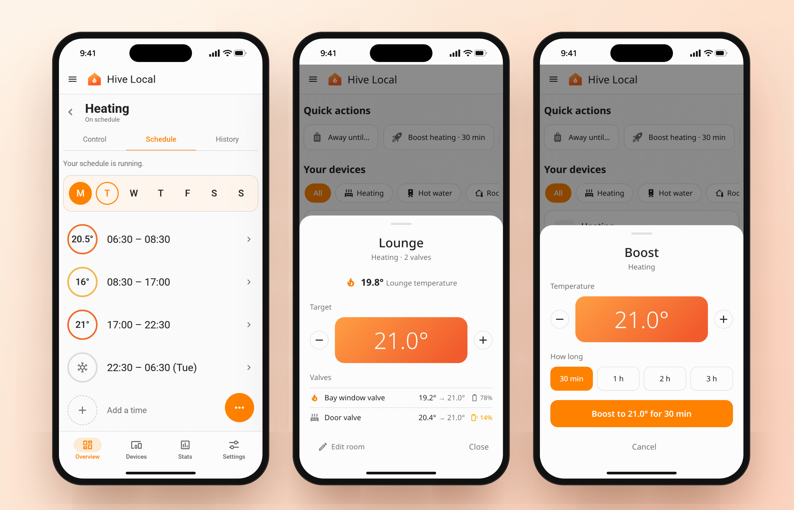
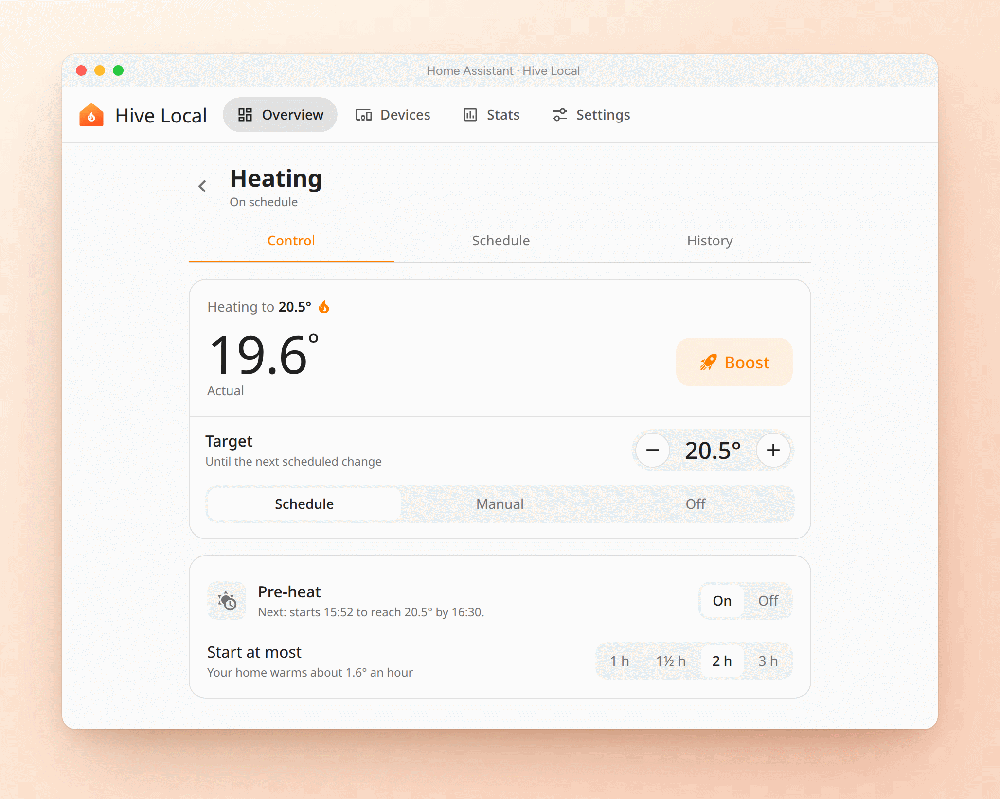
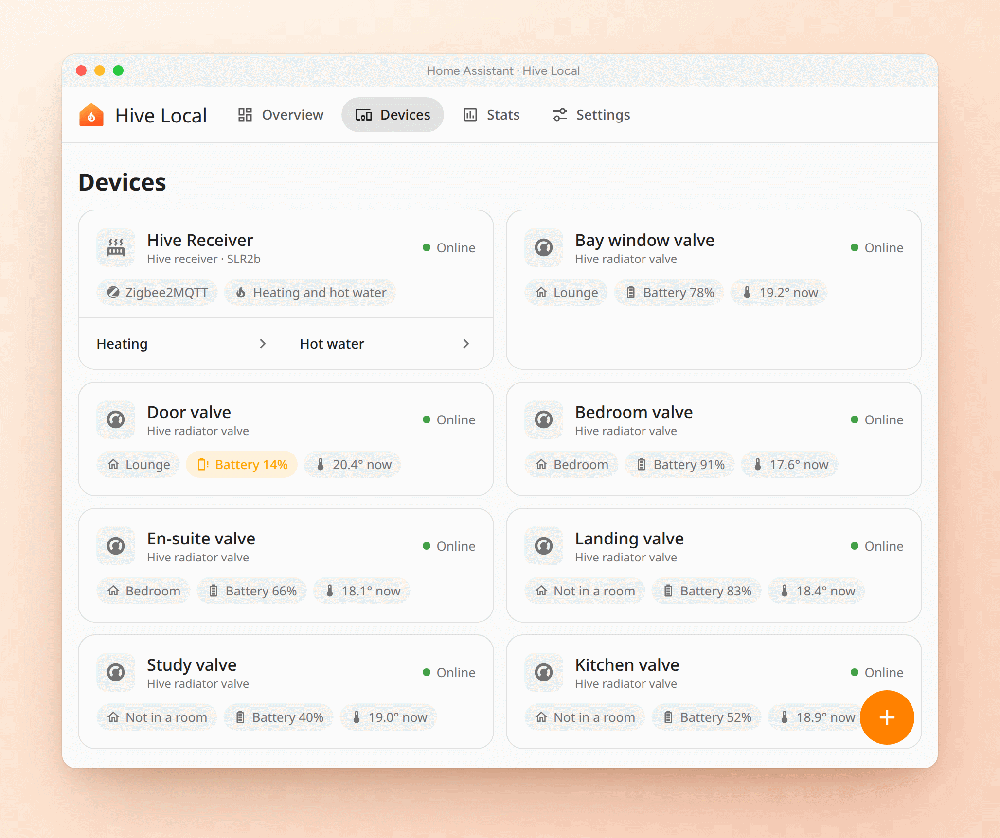
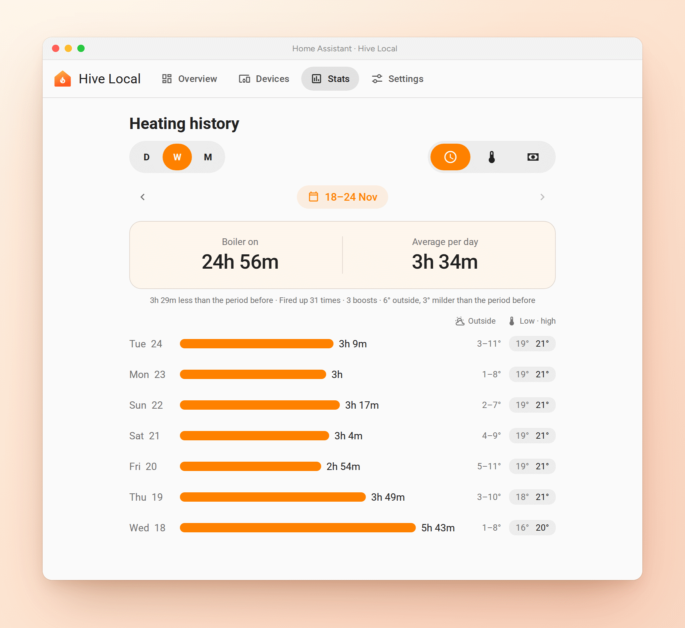
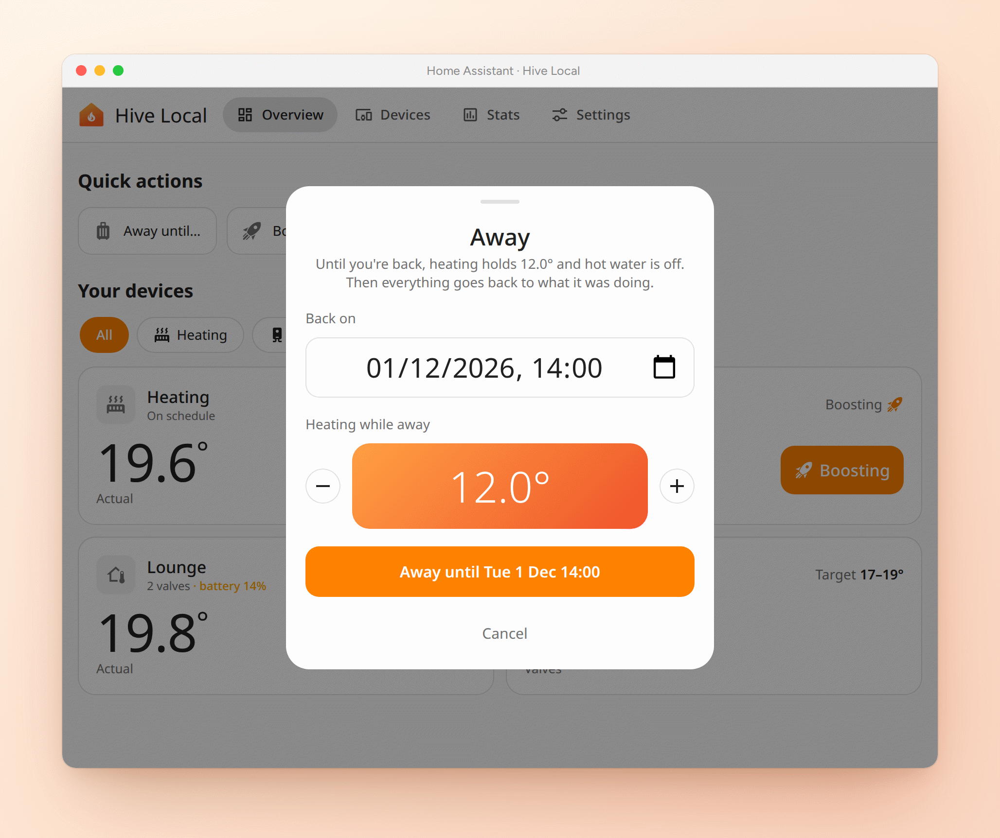
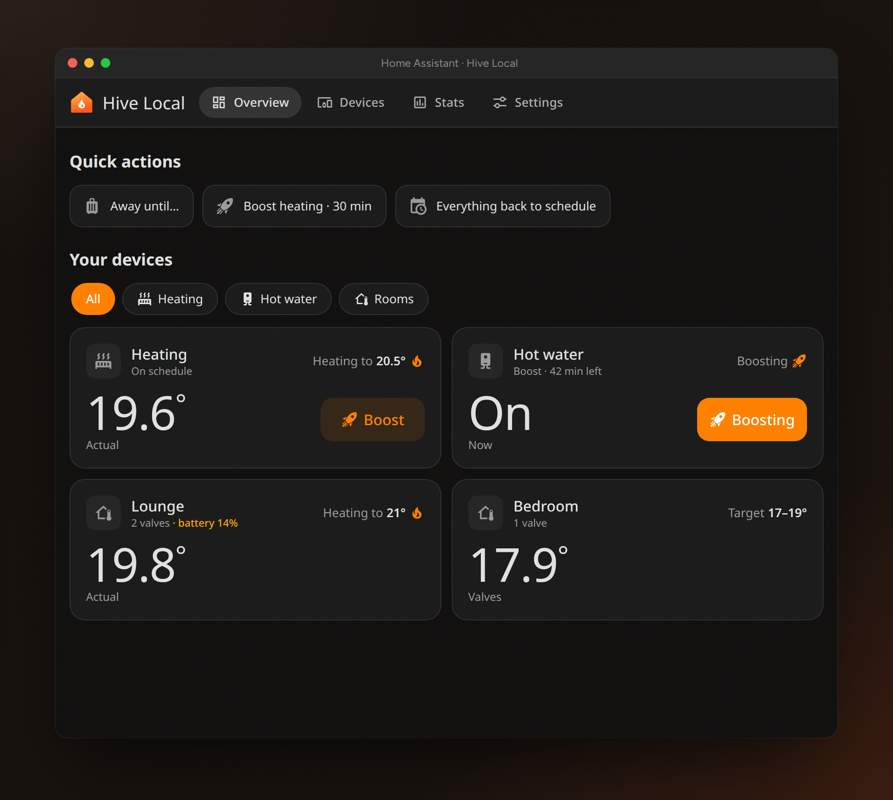

<h1>
  <picture>
    <source media="(prefers-color-scheme: dark)" srcset="https://raw.githubusercontent.com/elliotwestlake/hive-local/main/docs/logo/logo-dark.png">
    
  </picture>
</h1>

Local control of Hive heating and hot water from Home Assistant, with no Hive cloud and no Hive hub. It adds a **Hive** sidebar panel and entities for boost and mode. Schedules are written to the receiver itself, so they keep running if HA is down.

Works with Hive receivers (SLR1, SLR1b/c/d, OTR1, SLR2, SLR2b/c/d) paired to **Zigbee2MQTT** or **ZHA**.

Hive Local is an independent community project. It isn't affiliated with, endorsed by or supported by Hive or Centrica. "Hive" is used only to describe the hardware it works with.

> ⚠️ Early and experimental. Z2M includes the standard Zigbee `setWeeklySchedule` / `getWeeklySchedule` commands for these receivers but hides them from its UI. Reading works on a real SLR1-style receiver. Writing is still being tested, so read before you write, and check the change shows on the thermostat.

## Features

- **A Hive panel** in the sidebar: Overview, Devices, Stats and Settings, with a bottom tab bar on phones.
- **Schedules** read from and written to the receiver, a day at a time, so they keep running without HA.
- **Boost, Schedule / Manual / Off** and a target − / +, like the thermostat.
- **Rooms** of Hive radiator valves, with one target per room and battery warnings.
- **Stats:** how long the boiler ran, the temperature outside, and an estimated cost from your gas meter.
- **Pre-heat:** starts early so the house is warm by the time the schedule says.
- **Away until…:** holiday mode that fails safe if Home Assistant goes down.
- **Entities and actions** for automations, matching the retired Hive Local Thermostat integration.

## Install

<!-- ha-marketplace:exclude-start -->

<!-- ha-marketplace:exclude-end -->

1. Add this repo to the **Marketplace** (formerly HACS) as a custom *Integration* repository, install **Hive Local** and restart Home Assistant. (Or copy `custom_components/hive_local` into `config/custom_components/`.)
2.  and choose **Zigbee2MQTT** or **ZHA**, then your receiver (not the wall thermostat).
3. Open **Hive** in the sidebar, then **Read** your schedule before changing it.

Once it works, disable Zigbee2MQTT's or ZHA's own climate entities for the receiver. Full steps: [Installation](https://github.com/elliotwestlake/hive-local/wiki/Installation).

## Screenshots

| | |
|---|---|
|  |  |
| **Heating:** target, mode, boost and pre-heat. | **Schedule:** edit a day, copy it, save only what changed. |
|  |  |
| **Devices:** receivers and valves at a glance. | **Stats:** boiler time, outside temperature, cost. |
|  |  |
| **Away until…:** holiday mode. | Follows your Home Assistant theme. |

## Documentation

The [wiki](https://github.com/elliotwestlake/hive-local/wiki) covers everything in detail:

- [Installation](https://github.com/elliotwestlake/hive-local/wiki/Installation) · [The Hive panel](https://github.com/elliotwestlake/hive-local/wiki/The-Hive-panel) · [Schedules](https://github.com/elliotwestlake/hive-local/wiki/Schedules)
- [Rooms and radiator valves](https://github.com/elliotwestlake/hive-local/wiki/Rooms-and-radiator-valves) · [Stats and heating cost](https://github.com/elliotwestlake/hive-local/wiki/Stats-and-heating-cost)
- [Pre-heat](https://github.com/elliotwestlake/hive-local/wiki/Pre-heat) · [Holiday](https://github.com/elliotwestlake/hive-local/wiki/Holiday) · [Entities and actions](https://github.com/elliotwestlake/hive-local/wiki/Entities-and-actions)
- [Troubleshooting](https://github.com/elliotwestlake/hive-local/wiki/Troubleshooting) (including ZHA's "receiver goes red" fix) · [Development](https://github.com/elliotwestlake/hive-local/wiki/Development)

## Acknowledgements

- **[Hive Local Thermostat](https://github.com/andrew-codechimp/HA-Hive-Local-Thermostat)** by Andrew Jackson showed how to drive Hive receivers locally; Hive Local's entities and actions match it, so moving across feels familiar. **[HomeDash's fork](https://github.com/homedashHA/HA-Hive-Local-Thermostat)** keeps it going, and inspired the boost deadline.
- **mikestir** tracked down ZHA's "receiver goes red" problem in [zha-device-handlers#2776](https://github.com/zigpy/zha-device-handlers/issues/2776).
- The **[Drayton Wiser integration](https://github.com/asantaga/wiserHomeAssistantPlatform)**, whose sidebar panel inspired this one.
- **[Zigbee2MQTT](https://www.zigbee2mqtt.io/)** and **[zigpy](https://github.com/zigpy/zigpy)**, whose device definitions document the receivers.
